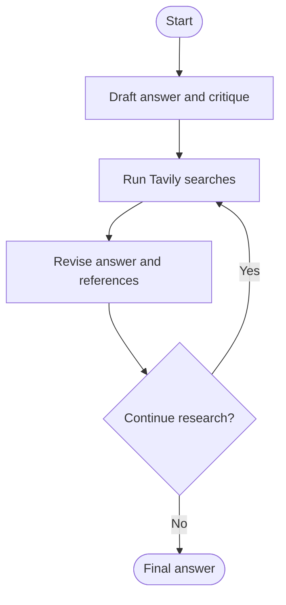

# Reflexion Agent

An AI research agent that drafts an answer, critiques its own response, searches the web, and revises the answer using retrieved evidence.

Built with **LangGraph**, **LangChain**, **Google Gemini**, **Tavily**, and **Pydantic**, this project demonstrates a Reflexion-style workflow with structured tool calls and iterative answer refinement.

## How it works

1. **Draft:** Gemini generates an initial answer, identifies missing and unnecessary information, and proposes search queries.
2. **Research:** Tavily runs the generated queries and returns search results to the graph.
3. **Revise:** Gemini uses the results and critique to revise the answer, with instructions to include numbered citations and references.
4. **Repeat or finish:** A conditional edge either starts another research cycle or ends the workflow.



## Features

- Graph-based orchestration with shared message state.
- Structured answer, reflection, search-query, and reference fields defined with Pydantic.
- Batched web searches through Tavily, configured for up to five results per query.
- Separate drafting and revision prompts.
- A research loop controlled by a tool-message count.
- Console output containing the graph definition, final answer, and complete message state.

## Tech stack

| Technology | Role |
| --- | --- |
| Python 3.13+ | Application code |
| LangGraph | Workflow graph, message state, and tool execution |
| LangChain | Prompt templates, model integration, and structured tools |
| Google Gemini | Answer generation, self-critique, and revision |
| Tavily | Web search |
| Pydantic | Structured output schemas |
| python-dotenv | Local environment variable loading |
| uv | Dependency and environment management |

## Getting started

### Prerequisites

- Python 3.13 or newer.
- uv installed and available in your terminal.
- A Google Gemini API key and a Tavily API key.

### 1. Install dependencies

Clone this repository, open a terminal in its root directory, and run:

```powershell
uv sync
```

### 2. Configure API keys

Create a `.env` file in the project root:

```dotenv
GOOGLE_API_KEY=your_google_api_key
TAVILY_API_KEY=your_tavily_api_key
```

The application loads these variables with `python-dotenv`. Local `.env` files are excluded by `.gitignore`.

### 3. Run the research agent

```powershell
uv run python main.py
```

The included example researches the AI-powered security operations center (SOC) domain, including startups and their funding. The script prints the graph as Mermaid text, runs the research workflow, and prints the final answer followed by the message state.

To run only the initial drafting chain:

```powershell
uv run python chains.py
```

## Customization

- **Research question:** Edit `HumanMessage(content=...)` in `main.py`.
- **Model:** Change the `model` argument in `ChatGoogleGenerativeAI` in `chains.py`. The current configuration uses `gemini-3.5-flash-lite`; access depends on your API account.
- **Prompts:** Adjust the drafting and revision instructions in `chains.py`.
- **Search results:** Change `max_results` in `tool_executor.py`.
- **Loop control:** Adjust `MAX_ITERATIONS` and `event_loop` in `main.py`. The current condition stops when the number of `ToolMessage` objects exceeds `MAX_ITERATIONS`; it does not count revision passes directly.

## Project structure

```text
reflexion-agent/
├── main.py                   # Graph definition and research example
├── chains.py                 # Gemini model, prompts, and drafting/revision chains
├── schemas.py                # Pydantic answer and reflection models
├── tool_executor.py          # Tavily query execution and ToolNode
├── src/reflexion_agent/
│   └── __init__.py           # Package entry-point placeholder
├── pyproject.toml            # Project metadata and dependencies
├── uv.lock                   # Dependency lockfile
└── README.md
```

## Current scope

This is a command-line research demo. The question is configured in source code, and citation inclusion and answer length are prompt instructions rather than programmatically verified guarantees. Review generated claims and references before relying on them.

If Gemini returns `503 UNAVAILABLE` with a high-demand message, wait and rerun the script. The installed model integration already includes retries, but persistent provider overload can still cause a request to fail.
